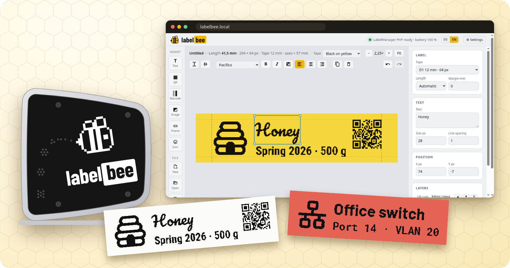
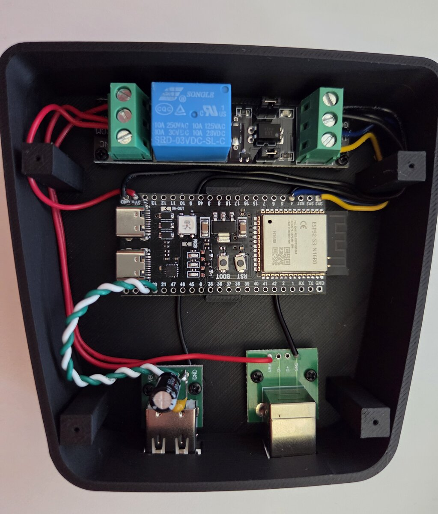
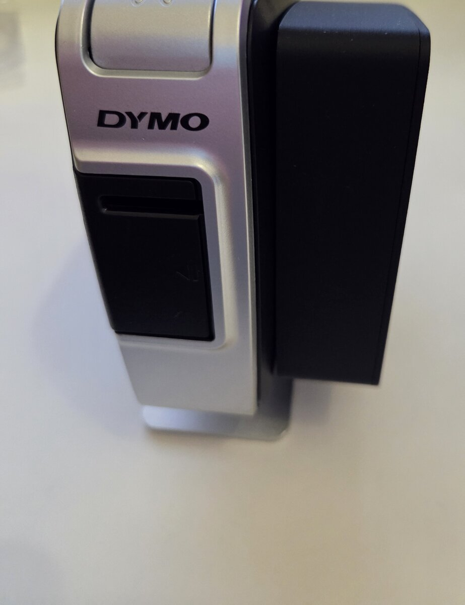
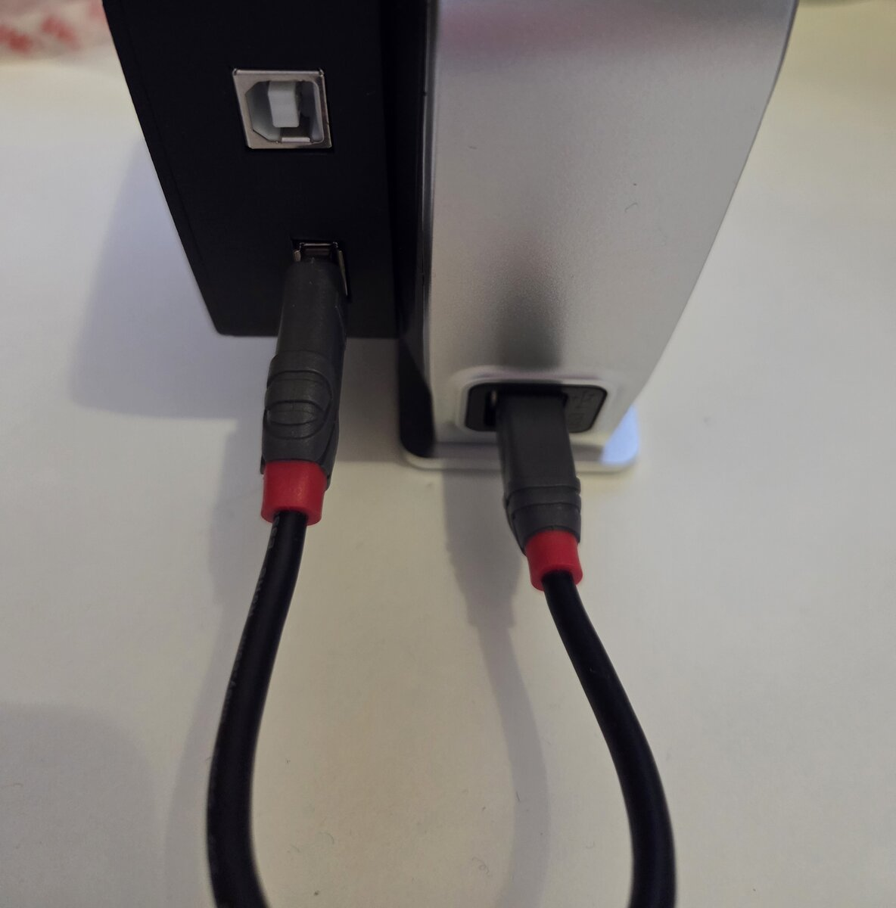

# labelbee

A network label printer: an **ESP32-S3** drives a **DYMO LabelManager PnP** over USB and serves a
label designer in the browser. Design a label on your phone or computer, press Print, done. No
driver, no app, no cloud.



## Features

- **Label designer in the browser**: text (18 embedded fonts), QR codes, barcodes (Code 128,
  Code 39, EAN-13), images (dithered to 1 bit), frames and over 7,000 Material Design Icons. Drag,
  resize, align, undo, and a preview in the colours of the tape.
- **Exact preview**: the label is drawn at the printer's 180 dpi, dot for dot, and the browser
  sends those dots. What you see is what is printed.
- **Files on the device**: labels are saved on the ESP32 (LittleFS), with previews and dates, and
  can be opened from any browser in the network.
- **Settings page**: printer status and battery, WiFi with network scan (DHCP or a fixed
  address), roaming between access points (802.11k/v), its own access point, time (NTP or the
  browser's clock), device name, firmware update over WiFi, live log, factory reset.
- **Always reachable**: labelbee always opens its own WiFi (`labelbee`) next to the home network,
  so it can be set up and used without one.
- **German and English** interface: follows the browser, with a switch that remembers your choice.
- **Case**: a 3D printed case (OpenSCAD) glued to the side of the printer, with a two colour logo
  on the lid.

The web interface is plain HTML, CSS and JavaScript without a build step; codes and images are
rendered in the browser, the firmware only stores files and talks to the printer.

## Hardware

| Part | Notes | Used here |
|---|---|---|
| DYMO LabelManager PnP | the printer; D1 tape 6, 9 or 12 mm (12 mm and 6 mm tested, 9 mm not yet) | |
| ESP32-S3 DevKitC-1 (N16R8 clone) | 16 MB flash, 8 MB PSRAM; its native USB pins drive the printer | [amazon.de](https://www.amazon.de/dp/B0D6B2CYNW) |
| USB-A socket breakout | to the printer, wired to GPIO19 (D−) and GPIO20 (D+) | [amazon.de](https://www.amazon.de/dp/B09YYHNCC3) |
| USB-B socket breakout | 5 V in from a USB power supply (5 V / 2 A) | [amazon.de](https://www.amazon.de/dp/B09YYHNCC3) |
| 3 V relay module (SRD-03VDC-SL-C) | switches the printer's 5 V, controlled by GPIO4 | [amazon.de](https://www.amazon.de/dp/B0CCS1QS39) |
| 100 µF and 100 nF capacitors | on the printer's 5 V | |

The links are the parts this one was built from; any equivalent part works (the case is measured
for these, see [case/](case/README.md)).

Wiring, pin positions and checks before the first power-on: [docs/wiring.md](docs/wiring.md).
The case and how to print it: [case/](case/README.md).

| Inside the case | On the printer | Power in (top), printer (bottom) |
|---|---|---|
|  |  |  |

In the photo of the open case the relay is at the top, the ESP32-S3 in the middle with its antenna
end free, and both USB breakouts at the bottom, which is the case's back edge: USB-B for the power
supply, USB-A with a short cable to the printer. The D+ and D− wires to the USB-A socket are
twisted.

## Building and flashing

The firmware uses ESP-IDF 6.0.1 through [PlatformIO](https://platformio.org/)
(`platform = espressif32@7.0.1`):

```sh
pio run                      # build
pio run -t upload            # flash over the USB-C socket with the USB serial chip
pio device monitor           # serial console, 115200 baud
```

> [!WARNING]
> Disconnect the power supply while the board is connected to a computer: it is not known whether
> the board separates the two 5 V sources.

Later updates go over WiFi, from the settings page or with

```sh
curl --data-binary @.pio/build/labelbee/firmware.bin http://labelbee.local/api/ota
```

A new firmware runs on probation: it counts as good once its web server is up (first answered
request, or 30 s after it started). If it crashes or restarts before that, the bootloader starts
the previous version again, and the settings page says so. WiFi is no criterion, since labelbee
also runs with only its own access point.

## First start

1. Power labelbee. It switches the printer on and opens the WiFi **labelbee** (password
   `labelbee`).
2. Join it and open `http://192.168.4.1/settings`. Under Network, choose your WiFi and save;
   labelbee restarts and joins it.
3. From then on open `http://labelbee.local/` in your home network (or its IP address, shown on
   the settings page). The own WiFi stays available as a way in.

The serial console has a `wifi <ssid> <password>` command as an alternative to step 2.

labelbee has **no authentication**: anyone in the network (and in its own WiFi) can print and
change settings. Give the access point a password and keep it in a network you trust.

## HTTP API

| Request | Purpose |
|---|---|
| `GET /api/status` | tapes, resolution, printer state, cassette, battery |
| `POST /api/print?tape=12mm&width=W[&copies=N]` | print; body: columns left to right, height/8 bytes each, top dot = MSB |
| `POST /api/test-print?tape=12mm[&offset=N]` | a test pattern; `offset` tries another head dot for the image to start at (to centre a tape), `ruler=1` prints a ruler over the whole head |
| `POST /api/power?on=0\|1` | switch the printer |
| `GET /api/templates`, `PUT\|DELETE /api/templates/<name>` | saved labels (designer JSON) |
| `GET\|POST /api/settings` | settings (POST restarts) |
| `GET /api/info`, `GET /api/log?since=N` | system information, log |
| `GET /api/scan` | WiFi networks in reach |
| `POST /api/time?ms=<unix ms>` | set the clock from the browser when there is no NTP |
| `POST /api/ota`, `POST /api/restart`, `POST /api/factory-reset[?files=1]` | maintenance |

Everything else is a file of the web interface. Messages from the firmware are in English; the
interface translates them.

## Repository

| Path | Contents |
|---|---|
| `src/` | firmware: USB host and printer (`printer.cpp`), print data (`label.cpp`), WiFi (`net.cpp`), settings (`config.cpp`), HTTP server (`web.cpp`), files (`store.cpp`), log (`logbuf.cpp`) |
| `www/` | web interface: designer (`index.html`, `app.js`), settings (`settings.html`, `settings.js`), translations (`i18n.js`), fonts and vendored libraries |
| `tools/` | build hooks (`pack_www.py` embeds `www/`, `version_stamp.py`) and generators for the icon data |
| `docs/` | wiring, the printer's USB protocol ([docs/protocol.md](docs/protocol.md)), images |
| `case/` | the case (OpenSCAD model and STL files) |
| `logo/` | the logo |

## Credits

The print protocol builds on [dymoprint](https://github.com/computerlyrik/dymoprint) and its
successor [labelle](https://github.com/labelle-org/labelle), and on the Java library
[dymo-print](https://github.com/piobyte/dymo-print). Embedded fonts, icons and libraries are listed
in [THIRD-PARTY-NOTICES.md](THIRD-PARTY-NOTICES.md).

DYMO and LabelManager are trademarks of their owners. This project is not affiliated with DYMO.

## Licence

[Apache License 2.0](LICENSE). Third-party parts keep their own licences: see
[THIRD-PARTY-NOTICES.md](THIRD-PARTY-NOTICES.md); the device lists them at `/licenses.html` (linked
from the settings, System).
