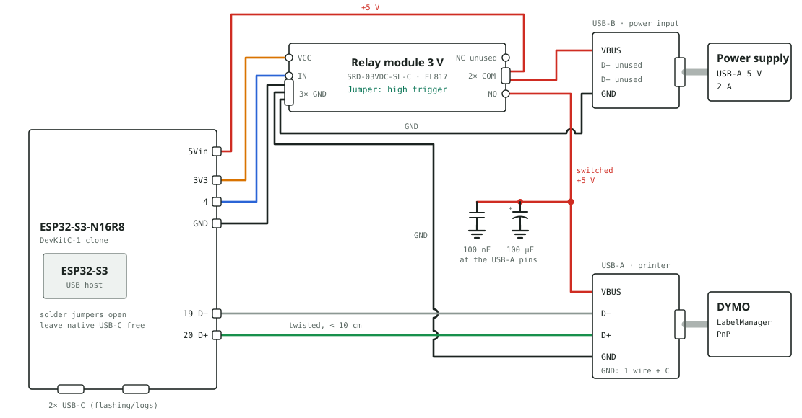

# LabelBee wiring

The ESP32-S3 acts as USB host for a DYMO LabelManager PnP. It switches the printer's 5 V through a
relay on GPIO4. Everything is soldered or screwed in place, no OTG adapter.

## Parts

| Part | Role | Size (manufacturer) | Measure for the case |
|---|---|---|---|
| ESP32-S3-N16R8, DevKitC-1 clone (2× USB-C) | controller, USB host | 28 × 57 mm | height with USB-C and pin headers; no mounting holes |
| Relay module SRD-03VDC-SL-C (3 V, EL817 optocoupler, flyback diode, screw terminals) | switches the printer's VBUS | 70 × 16 × 17 mm | holes; room for the screw terminals at both ends |
| USB-A socket on a 2.54 mm pin header | printer connection | 17 × 22 mm | socket height, overhang, holes |
| USB-B socket on a 2.54 mm pin header | power input | 20 × 20 mm | socket height, overhang, holes |
| USB-A power supply 5 V / 2 A + USB-A to B cable | supply | | |
| Electrolytic capacitor 100 µF / 50 V, capacitor 100 nF ("104") | buffer on the printer's VBUS | | diameter and height of the electrolytic |
| Stranded wire AWG 24 (enough for everything) | wiring | | |

## Wiring (as built)

The power input runs through the relay's screw terminals. COM takes two wires, the GND terminal
is the star point with three wires. Both USB sockets sit on the right.

| From | To | Wire | Note |
|---|---|---|---|
| USB-B VBUS | relay COM | AWG 24 | printer max. 500 mA + ESP |
| relay COM | ESP `5Vin` | AWG 24 | second wire in COM |
| relay NO | USB-A VBUS | AWG 24 | printer off as long as the relay is not energized |
| USB-B GND | relay GND | AWG 24 | star point |
| USB-A GND | relay GND | AWG 24 | star point; never interrupt |
| ESP `GND` | relay GND | AWG 24 | star point; route it close along D+/D− |
| ESP `19` | USB-A D− | AWG 24 | twist D+ and D− together, under 10 cm |
| ESP `20` | USB-A D+ | AWG 24 | |
| ESP `3V3` | relay VCC | AWG 24 | not to 5 V |
| ESP `4` | relay IN | AWG 24 | optional 10 kΩ from IN to GND against a click at boot |
| 100 µF + 100 nF | USB-A VBUS ↔ GND | directly at the pins | electrolytic: stripe (−) to GND |

Left unconnected: D+/D− of the USB-B socket, relay NC, the board's native USB-C socket, and
GPIO35 to GPIO37 (used by the octal PSRAM on the N16R8).

Set the relay jumper to **high trigger** (GPIO4 = 1 → printer on).

The return path of the USB signal runs through the star point instead of right next to D+/D−.
At full speed and with short wires this should be enough. If the printer is sometimes not
detected, add a thin wire from ESP GND (next to 19/20) directly to USB-A GND.

Several wires in one terminal: two in a 0.5 mm² ferrule, three in a 0.75 mm² ferrule, otherwise
twist the ends together. **Do not tin** the wire ends: solder creeps under the screw and the
terminal works loose. After tightening, pull on every wire.

### Pin positions on the board

The clone's pinout matches the original DevKitC-1:

- Left side from the top (USB-C end): `GND · GND · 19 · 20 · 21 · 47 · …`. Use one of the two
  GND pins for the USB-A socket, so D−, D+ and GND sit next to each other.
- Right side, top: `5Vin · GND`.
- Right side, bottom: `… 4 · RST · 3V3 · 3V3`. GPIO4 is directly above RST, do not mix them up.

### Capacitors at the relay instead of at the USB-A socket

This works too (between NO and GND of the relay module, legs clamped into the screw terminals),
but is less effective, especially for the 100 nF capacitor. In that case place the relay at most
about 10 cm from the USB-A socket and also connect relay GND directly to GND of the USB-A socket
with AWG 24.

## Checks

Before soldering:

- Check the breakouts with a multimeter: which pin is VBUS, D−, D+, GND (the product photo shows
  "D+" twice). The order on USB-A is VBUS, D−, D+, GND.
- No continuity between D+ and D−; find out what the small black component on the breakouts is
  connected to.
- Confirm the "19" marking on the board, and which USB-C socket is the native one (usually the
  one on the bottom).

Before powering up for the first time:

1. Continuity tester: no short between 5 V and GND.
2. Power up without the printer: 5 V at `5Vin`, 0 V at the USB-A socket.
3. Set GPIO4 high with test firmware: the relay clicks, 5 V at the USB-A socket.
4. Only then plug in the printer.

## Rules

- **Always switch the +5 V line, never GND.** GND must stay connected all the time, otherwise
  the printer finds its ground through D+/D−.
- Never swap D+ and D− (GPIO19 = D−, GPIO20 = D+) and never connect them to each other.
- Use only +5 V and GND from the power supply, never its D+/D−.
- Do not connect the power supply to `5Vin` and a PC to one of the board's USB-C sockets at the
  same time, as long as it is unclear whether the board separates the 5 V sources with a diode.
  Unplug the power supply for flashing. Leave the native USB-C socket empty during operation; it
  is wired in parallel to GPIO19/20.
- Leave the solder jumpers on the board ("USB-OTG", "IN-OUT") open; they are not needed.
- Relay GPIO: do not use a strapping pin (GPIO0, 3, 45, 46). GPIO4 is safe.
- Relay coil: 65 mA from the 3.3 V regulator. If WiFi drops out, power the relay separately.
- The USB-B contacts and thin cable wires limit the current (about 1.5 A). Use a short, decent
  A to B cable; the PnP's current draw has not been measured yet.

## Alternatives to the relay (high side)

- USB load switch IC: TPS2065DBVR (1 A), TPS2051BDBVR (0.5 A), AP2553 or SY6280. Enable directly
  from a 3.3 V GPIO, with current limiting and soft start.
- P-channel MOSFET (for example IRF4905 or AO3401) with an N-channel MOSFET or NPN driver (for
  example IRLZ44N, 2N7002, BC547): 10 kΩ gate to +5 V, 1 kΩ GPIO to driver gate, 100 kΩ GPIO to GND.

Low-side MOSFET modules (VIN±/OUT±) are unsuitable because they switch GND.
